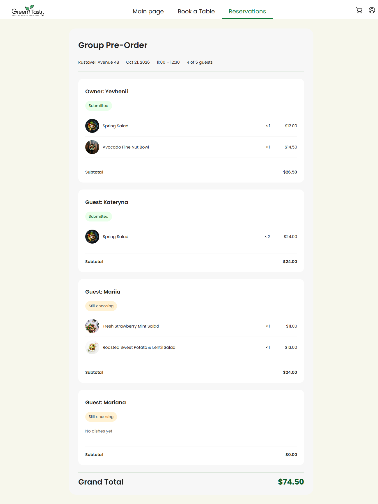
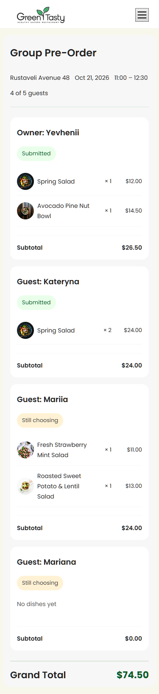

# EPAM IT Marathon — Frontend Homework #6
## Level 1: Owner Group Pre-Order

Implemented a static Owner review screen using the supplied preview data:
- reservation address, date, time and participant count;
- Owner and Guest cards with dishes, quantities and prices;
- text statuses: Submitted / Still choosing;
- empty cart message;
- participant subtotals and Grand Total ($74.50);
- responsive layout checked at 375 px.

Uses standalone Angular components, signal inputs, signals, DatePipe,
CurrencyPipe and SCSS with the project's shared colors.

Scope: Level 1 only. API loading and Submit functionality are not implemented.

## Run locally

1. Download and extract source-code.zip into a separate folder.
2. Copy src/assets from the original green-and-tasty workshop archive
   into the extracted project's src/assets directory.
   These unchanged starter assets are excluded to keep the upload small.
3. Open a terminal in the extracted folder and run:

```sh
npm ci
npm start
```

Open:
http://localhost:4200/reservations/demo-reservation/group-order?demo

No AWS account or backend is needed for this screen.

## Validation

- Homework test suite: 39 tests passed.
- TypeScript checks for app and tests completed without reported errors.
- Production build completed: Bundle check passed.
- Existing bundle-size and dependency warnings remain.
- Desktop and 375 px mobile layouts visually checked.

```sh
npx tsc -p tsconfig.app.json --noEmit
npx tsc -p tsconfig.spec.json --noEmit
npm run test:hw
```

Production build in PowerShell:

```powershell
$env:BACKEND_URL = "https://example.com"
npm run build
```

Tests ran using Microsoft Edge (Chromium) via CHROME_BIN:

```powershell
$env:CHROME_BIN = "C:\Program Files (x86)\Microsoft\Edge\Application\msedge.exe"
npm run test:hw
```

## Main changes

- src/app/components/group-orders/participant-card/
- src/app/pages/group-order-page/
- src/app/app.routes.ts
- Supplied practice and Level 1 tests copied into src/app.

## AI assistance

ChatGPT assisted with implementation, styling, commands and troubleshooting.
I ran the checks locally and reviewed the rendered desktop and mobile screens.

## Screenshots

### Desktop


### Mobile — 375 px


Based on the EPAM workshop starter project.
